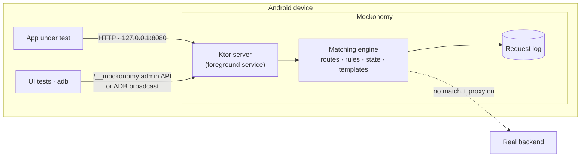

# Mockonomy

**An HTTP mock server that runs on your Android device — and that your tests can control.**

Mockonomy runs a configurable mock API on the phone itself. The app you are testing talks
to it over `127.0.0.1`: no backend, no shared Wi-Fi, no IP addresses, no firewall rules.
Define routes and responses in the app, then drive scenarios from your UI tests through an
HTTP or ADB automation API.

Requires Android 8.0 (API 26) or newer.

---

## Why

Mobile developers and QA engineers often end up waiting on a backend: an endpoint that is
not built yet, a staging server that is down, an error case that is hard to reproduce
("what does the app do when checkout returns a 500?"). Desktop mock tools help, but
pointing a phone at a laptop means shared networks, IP addresses and firewalls — and it does
not travel with the device into a CI run.

Mockonomy puts the mock on the device:

- **Local by design.** The server binds to `127.0.0.1` only; nothing is exposed to the
  network.
- **Controllable from tests.** Espresso, Appium or a shell script can switch responses, set
  states, reset counters and verify the requests your app actually sent.
- **No backend needed.** Import an OpenAPI or Mockoon file, or record real traffic through
  the proxy and turn it into mocks.

---

## How it works



1. **Environments.** An environment is a set of routes served on one port, stored as one
   JSON file. Several environments can run side by side, each on its own port. A foreground
   service keeps them running while you switch to the app under test.
2. **Routes and responses.** A route is a method plus a path pattern such as
   `GET /users/:id`. Each route has one or more responses; one of them is the default.
3. **Matching.** For every request Mockonomy finds the most specific matching route (a
   literal segment beats a `:param`), then picks a response:
   - the first response whose **rules** pass (query, header, body, path parameter or request
     number), otherwise
   - the **default** response.

   A route can also return its responses **in sequence** (for polling flows), filter them by
   a **named state** (logged out → logged in), or be **pinned** to one response by a test.
4. **Rendering.** The body may contain templates such as `{{path.id}}`,
   `{{body.user.name}}`, `{{uuid}}` or `{{now}}`.
5. **Fallback.** If nothing matches, Mockonomy answers `404` with an explanation — or, with
   the proxy on, forwards the request to your real backend and can record the response so
   you can turn it into a mock.
6. **Logs.** Every request is logged together with the reason it got its response, and can
   be exported as cURL or HAR.

The exact behavior is specified in [`spec/`](spec/README.md) and pinned down by golden test
fixtures.

---

## Features

- **Environments** — create, duplicate, import and export; start and stop each one
  independently; a notification shows what is running
- **Route and response editor** — status code picker, latency, headers, a JSON body editor
  with highlighting and validation, paste from the clipboard or load from a file
- **Response rules** — `QUERY`, `HEADER`, `BODY` (dot notation), `PATH_PARAM` and
  `REQUEST_NUMBER` targets with `EQUALS`, `CONTAINS`, `REGEX` and `EXISTS`, plus `invert` and
  `AND` / `OR`
- **Sequential responses** (`STAY_ON_LAST` / `CYCLE`) and a **named state machine**
  (`whenState` / `setState`)
- **Templating** in response bodies
- **Request log** with a match explanation, cURL and HAR export, and "create mock from this
  request"
- **Proxy** for unmatched requests, with record & replay and an opt-in TLS exemption for
  self-signed staging servers
- **Import** from OpenAPI 3.x (JSON or YAML) and Mockoon, with a report of everything that
  could not be imported
- **Automation API** over HTTP and ADB broadcasts — off by default, with an optional token
- **Setup guide** with step-by-step connection diagnostics
- Light and dark theme

---

## Quick start

1. **Install Mockonomy** on your device: download the APK from
   [Releases](../../releases), or [build it from source](#building-from-source).
2. **Start the example environment.** On first launch Mockonomy creates an "Example API"
   environment. Tap ▶ to start it; it serves `http://127.0.0.1:8080`.
3. **Allow cleartext HTTP to loopback in your app** (debug builds only) with a network
   security config — see [docs/getting-started.md](docs/getting-started.md).
4. **Call it from your app:** `GET http://127.0.0.1:8080/ping` → `{"status":"ok"}`
5. **Make it yours:** add routes and responses, or import an OpenAPI or Mockoon file.

You can also call it from your computer:

```bash
adb forward tcp:8080 tcp:8080
curl http://127.0.0.1:8080/users/1
```

---

## Controlling mocks from tests

Turn on the automation API in the app (the plug icon on the top bar), give your routes and
responses readable keys, and control scenarios from your tests:

```kotlin
private val mock = Mockonomy(port = 8080)   // a small OkHttp client, see docs/automation-api.md

@Before fun setUp() {
    mock.reset()                                // isolate the test
    mock.setResponse("get-user", "not-found")   // pin a route to one response
}

@Test fun showsEmptyState_whenTheUserDoesNotExist() {
    // ... drive the UI with Espresso ...

    // verify what the app actually sent
    assertThat(mock.logs(method = "GET", path = "/users/42")).contains("\"count\":1")
}
```

Or set a scenario up from the shell before a test run:

```bash
adb shell am broadcast -a com.mockonomy.automation.SET_STATE \
  -n com.mockonomy/.automation.AutomationBroadcastReceiver --es state logged_in
```

The full reference — every endpoint, error codes, a drop-in Kotlin client, and Appium
(Python) and curl examples — is in [docs/automation-api.md](docs/automation-api.md).

---

## Building from source

Requirements: JDK 21 (for example the JBR bundled with Android Studio) and the Android SDK.

```bash
./gradlew :app:assembleDebug    # → app/build/outputs/apk/debug/app-debug.apk
./gradlew :app:installDebug     # install on a connected device
./gradlew build                 # all modules: unit tests, lint, R8 release build
```

On macOS with Android Studio you can point Gradle at its bundled JDK:

```bash
export JAVA_HOME="/Applications/Android Studio.app/Contents/jbr/Contents/Home"
```

---

## Project structure

| Module | Contents |
|---|---|
| `:engine` | Pure Kotlin/JVM: the data model, matching, rules, templating and state. No Android dependencies, so its tests run in milliseconds without an emulator |
| `:data` | Environment file storage and schema migration, the Room request log, OpenAPI and Mockoon import, cURL and HAR export |
| `:server` | The Ktor (CIO) server inside a foreground service, the proxy, the automation API |
| `:app` | Jetpack Compose UI (Material 3), ViewModels, the ADB broadcast receiver |
| `test-client/` | A minimal app for manually testing a connection to Mockonomy |
| `spec/` | The behavior contract: configuration schema, behavior rules and golden fixtures |

Built with Kotlin, Jetpack Compose, Ktor, kotlinx.serialization, Room, DataStore, Hilt and
okio.

---

## Security and privacy

- The server binds to loopback (`127.0.0.1`) only.
- The automation API is off by default. Any app on the device can reach loopback, so turn it
  on deliberately, and set a token on shared devices.
- Request logs stay on the device and are never uploaded.
- Environment exports and automation log reads mask sensitive headers (`Authorization`,
  `Cookie`, …) by default.

## Limitations

- Android only.
- The mock server speaks plain HTTP — no HTTPS, WebSocket or SSE.
- The app under test needs a cleartext exception for `127.0.0.1` in its debug build.
- The `RANDOM` response mode and `COOKIE` rules are defined in the schema but not supported
  yet.
- Automation cannot start a server from the background; start it in the app, or with
  `adb shell am start -n com.mockonomy/.MainActivity --es env <key>`.

---

## Contributing

Contributions are welcome — see [CONTRIBUTING.md](CONTRIBUTING.md).

## License

Mockonomy is licensed under the [Apache License 2.0](LICENSE). Third-party components are
listed in [THIRD_PARTY_LICENSES.md](THIRD_PARTY_LICENSES.md).
